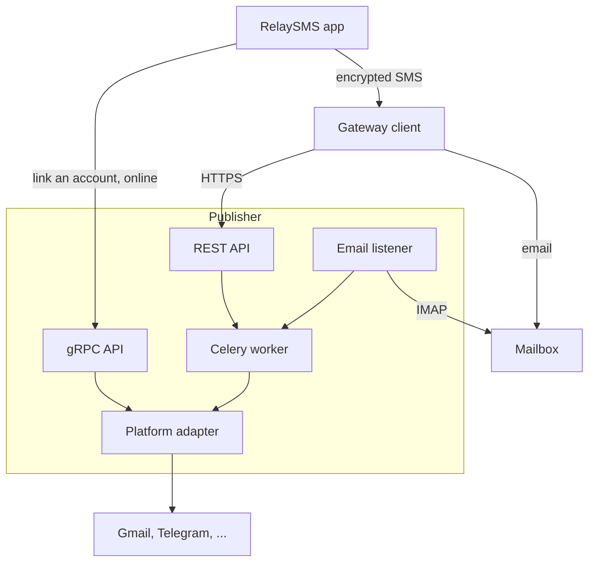

# RelaySMS Publisher

The Publisher posts to online platforms (Gmail, Telegram, Mastodon and more) from content people send by SMS, so they can publish without an internet connection.

## How it works

1. While online, a user links an account through the gRPC API. The Publisher stores its token encrypted.
2. Offline, the app encrypts the content and sends it by SMS to a gateway client, a phone number that relays SMS.
3. The gateway client posts the payload to the REST API, or emails it to a mailbox the Publisher reads.
4. A Celery worker decrypts the payload and publishes it through the platform's adapter.

## What you need

- A server running Ubuntu 24.04 or Debian 13, with a domain name pointing at it
- Developer credentials from each platform you offer, such as a Google Cloud OAuth client for Gmail
- At least one gateway client: a phone number whose SMS reach the REST API or a mailbox

## Where to start

| To | Read |
| --- | --- |
| Offer a platform | [Managing adapters](platforms/manage.md) |
| Relay SMS to the Publisher | [Managing gateway clients](gateway-clients/manage.md) |
| Build a client | [gRPC API](reference/grpc-api.md) and [REST API](reference/rest-api.md) |
| Understand the protocol | [RelaySMS whitepaper](explanation/relaysms-whitepaper.pdf) |
