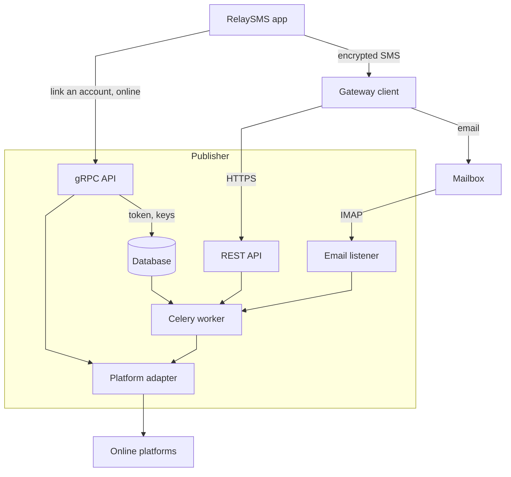

# RelaySMS Publisher

Publishes to online platforms, such as Gmail, from content people send by SMS, so they can post without an internet connection.

## How it works

1. While online, a user links an account through the gRPC API. The Publisher stores its token encrypted.
2. Offline, the app encrypts the content and sends it by SMS to a gateway client, a phone number that relays SMS.
3. The gateway client posts the payload to the REST API, or emails it to a mailbox the Publisher reads.
4. A Celery worker decrypts the payload and publishes it through the platform's adapter.

## Key terms

- **Gateway client**: a phone number that relays SMS to the Publisher, such as an Android phone running Deku SMS. See [Connecting a relay](gateway-clients/connect-a-relay.md).
- **Adapter** (platform adapter): the plugin that publishes to one platform, such as Gmail, installed from its own repository. See [Managing adapters](platforms/manage.md).
- **Linked account**: a user's account on a platform, authorized once while online. The Publisher stores its token encrypted.
- **OAuth2 and PNBA**: how accounts link. OAuth2 goes through the platform's consent page, as for Gmail. Phone number-based authentication (PNBA) uses a code sent to the user's phone, as for Telegram. The [provider guides](platforms/manage.md#provider-guides) give each platform's protocol.
- **Offline payload**: content sent without a linked account, published through [RelaySMS Mail](platforms/relaysms-mail.md). See [Offline publishing](configuration/offline-publishing.md).

The [glossary](reference/glossary.md) defines the rest, and [Architecture](explanation/architecture.md) shows every component.

## Where to start

| To | Read |
| --- | --- |
| Try the Publisher on your machine | [Quick start](getting-started/quick-start.md) |
| Run it in production | [Requirements](installation/requirements.md), then [Install on a server](installation/server.md) |
| Offer a platform | [Managing adapters](platforms/manage.md) |
| Relay SMS to the Publisher | [Managing gateway clients](gateway-clients/manage.md) |
| Build a client | [gRPC API](reference/grpc-api.md) and [REST API](reference/rest-api.md) |
| Understand the protocol | [Security model](explanation/security-model.md) and the [RelaySMS whitepaper](explanation/relaysms-whitepaper.pdf) |

## Getting help

- Ask questions and report bugs in the [issue tracker](https://github.com/smswithoutborders/RelaySMS-Publisher/issues). [CONTRIBUTING.md](https://github.com/smswithoutborders/RelaySMS-Publisher/blob/main/CONTRIBUTING.md#where-to-start) says what a useful report has.
- Report vulnerabilities privately, as [SECURITY.md](https://github.com/smswithoutborders/RelaySMS-Publisher/blob/main/SECURITY.md) describes.
