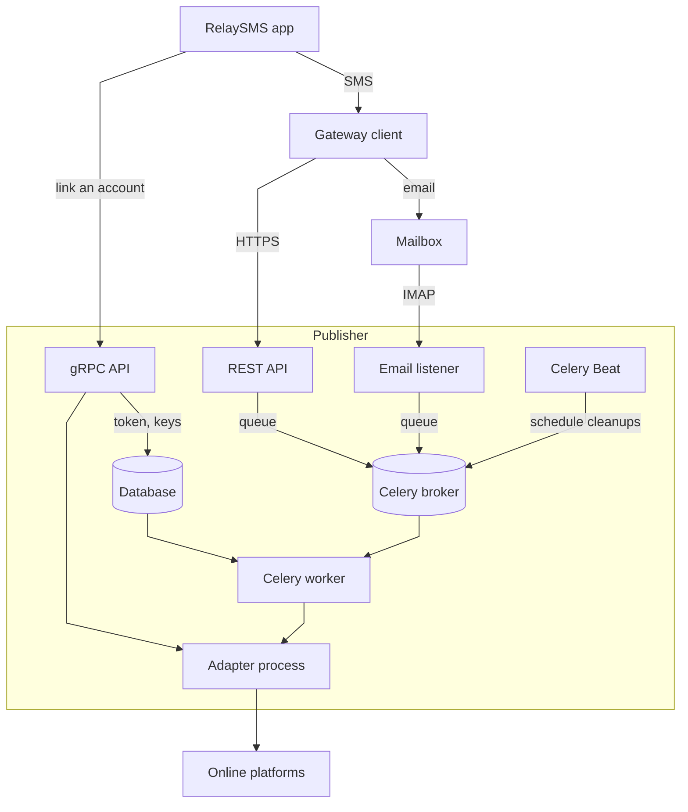

# Architecture

The Publisher is a set of services sharing one database and one Celery broker. Each platform is reached through an adapter that runs as its own process.

Every service in the Publisher also reads and writes the database.

## Services

| Service | Does |
| --- | --- |
| gRPC API | Links and unlinks accounts through their adapters, stores their tokens encrypted, and exchanges ephemeral public keys with the app (`SyncKeys`) |
| REST API | Takes payloads from gateway clients, and serves the admin endpoints, publication stats and public lists |
| Email listener | Reads payloads that gateway clients email to a mailbox |
| Celery worker | Decrypts each queued payload and publishes it through the platform's adapter, and installs and updates adapters |
| Celery Beat | Schedules the cleanup jobs and, when set, the worker heartbeat |

The database holds linked accounts, keys, credentials, adapters, gateway clients, the audit log and publication stats. The broker carries the queue between the services and the worker; with the default SQLite broker it's two files in `data/`.

## Adapters

Each adapter is a Python package installed from its own repository into its own virtualenv. The Publisher runs it as a separate process for each call, with a 60-second limit, and talks to it over JSON-RPC on standard input and output. It gets its own config and state directories under `data/platforms/` and a few environment variables, not the Publisher's settings. It runs as the service user ([security model](security-model.md#adapters)). See [Writing an adapter](../developers/writing-an-adapter.md).

## A publication, step by step

1. A gateway client posts a payload to `POST /v1/publications`, or emails it.
2. The REST API or the email listener checks its structure, replaces the sender's address with a keyed hash, and queues it.
3. A multi-part payload waits until all its segments arrive.
4. The worker finds the payload's keys, decrypts it, and calls the platform's adapter to publish it.
5. The keys are used up once the payload decrypts and is ready to send, so a platform's refusal doesn't free them and a payload never publishes twice. A failure before that leaves them usable.
6. The outcome is recorded in the publication stats.

The [security model](security-model.md) covers the keys and encryption.
