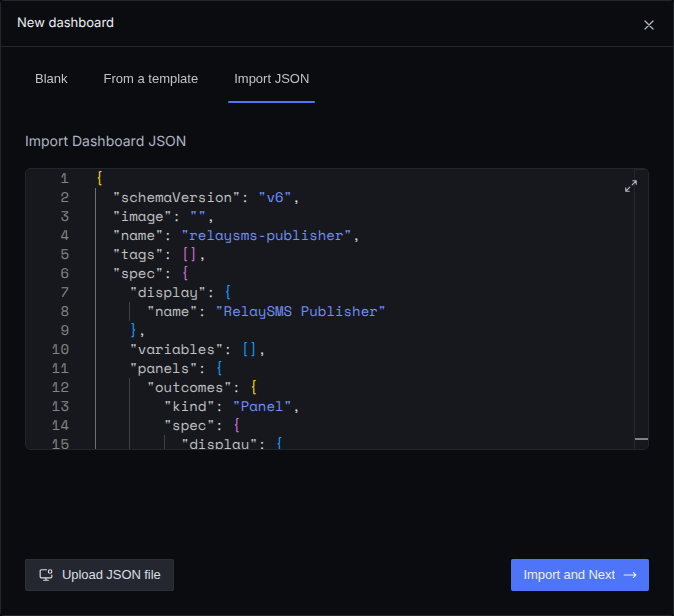
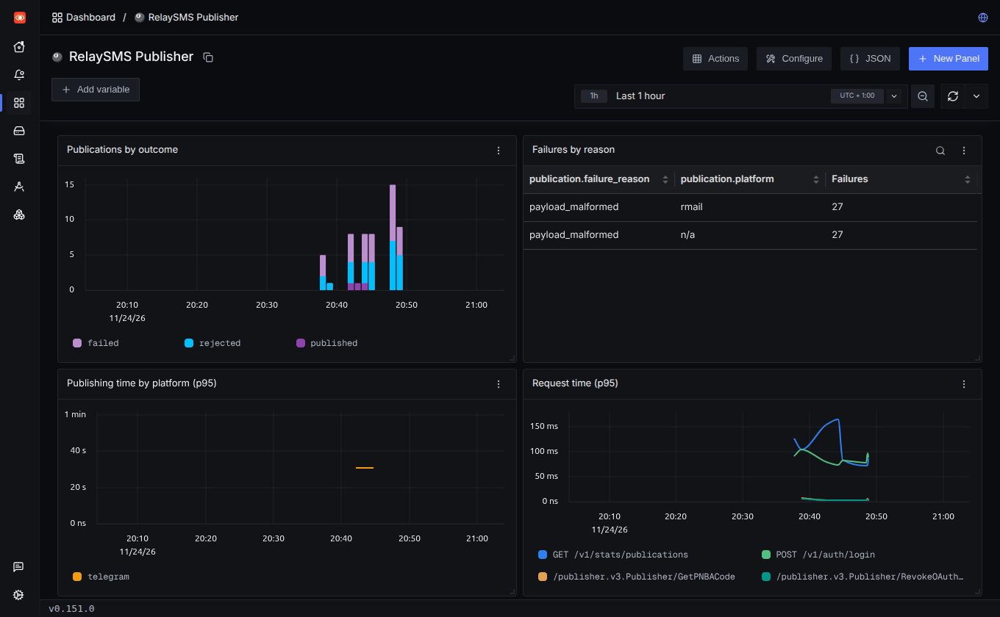
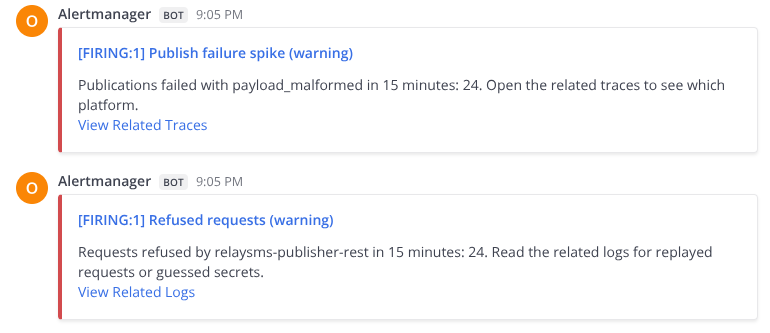
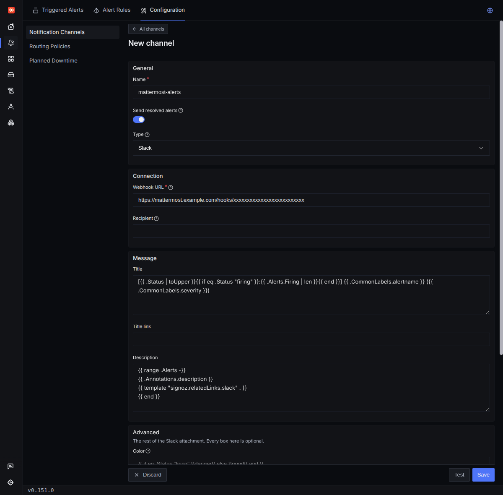
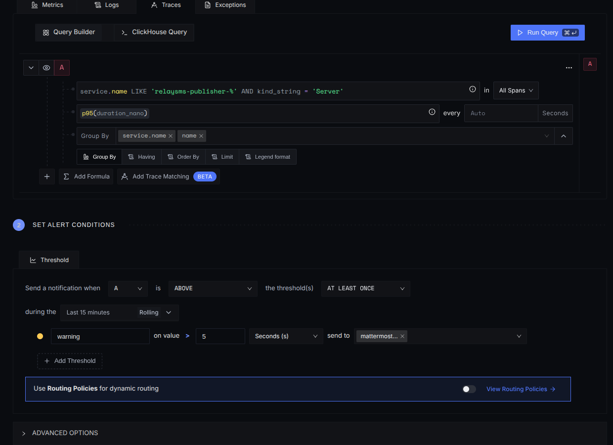
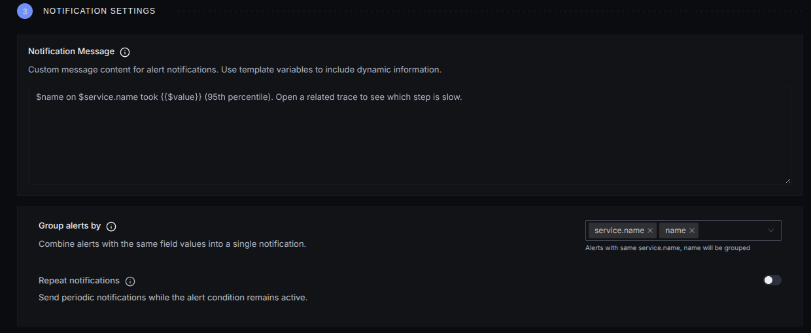

# Observability

Self-hosted tracing, metrics and log export (SigNoz) and uptime monitoring (Uptime Kuma) for the Publisher's services. Both are optional; tracing, metrics and log export stay off while `OTEL_EXPORTER_OTLP_ENDPOINT` is blank.

## Set up

During install:

```bash
sudo ./install.sh --setup-observability
```

On an existing install, from the install directory:

```bash
sudo ./scripts/setup-observability.sh
```

| `install.sh` | `setup-observability.sh` | Does |
| --- | --- | --- |
| `--observability-site-name <DOMAIN>` | `--site-name <DOMAIN>` | Puts nginx and a Let's Encrypt certificate in front of SigNoz |
| `--observability-kuma-site-name <DOMAIN>` | `--kuma-site-name <DOMAIN>` | The same for Uptime Kuma, on a different domain |
| None | `--signoz-email`, `--signoz-password` | SigNoz admin account |
| None | `--signoz-smtp-host`, `--signoz-smtp-port`, `--signoz-smtp-username`, `--signoz-smtp-password`, `--signoz-smtp-from` | SMTP relay for SigNoz's email alerts |
| None | `--signoz-webhook-url <URL>` | Creates the [dashboard](#dashboard), and [alerts](#alerts) sent to this Slack or Mattermost webhook |
| None | `--signoz-alert-email <ADDRESS>` | The same, with alerts sent to this address through the SMTP relay |
| None | `--skip-tracing` | Leaves tracing off |

`scripts/setup-observability.sh --help` lists every flag. The script:

- installs Docker if it's missing;
- writes `observability/signoz/casting.yaml` from its template, binds the SigNoz UI and OTLP ports to `127.0.0.1`, starts SigNoz and creates the admin account;
- starts Uptime Kuma on `127.0.0.1:3001`, or the port you choose;
- installs `requirements-observability.txt` and sets `OTEL_EXPORTER_OTLP_ENDPOINT`, unless given `--skip-tracing`;
- with `--site-name` or `--kuma-site-name`, writes and enables the nginx sites and runs Certbot;
- with `--signoz-webhook-url` or `--signoz-alert-email`, creates the dashboard, notification channels and alert rules that SigNoz lacks.

Open SigNoz through its domain, or through an SSH tunnel at <http://localhost:8090>:

```bash
ssh -L 8090:127.0.0.1:8090 <USER>@<HOST>
```

Log in with the admin account, then set retention under Settings > Workspace > Retention Controls.

## Uptime Kuma monitors

Open Uptime Kuma through its domain, or through an SSH tunnel at <http://localhost:3001>:

```bash
ssh -L 3001:127.0.0.1:3001 <USER>@<HOST>
```

Then add a monitor for each service. Health checks are left out of traces. Passing ones are also left out of the REST access log, and the gRPC API logs them only when `LOG_LEVEL` is `debug`.

### REST

Monitor Type "HTTP(s)", URL `https://<DOMAIN>/health`.

### gRPC

1. Choose Monitor Type "GRPC(S) - Keyword".
2. Set gRPC URL to `<DOMAIN>:443` and turn on Enable TLS.
3. Set Service Name to `grpc.health.v1.Health` and Method to `check`.
4. Set gRPC Body to `{"service":"publisher.v3.Publisher"}` and Keyword to `SERVING`.
5. Paste this into Protobuf:

<details>
<summary>Health check protobuf</summary>

```proto
syntax = "proto3";
package grpc.health.v1;

message HealthCheckRequest {
  string service = 1;
}

message HealthCheckResponse {
  enum ServingStatus {
    UNKNOWN = 0;
    SERVING = 1;
    NOT_SERVING = 2;
    SERVICE_UNKNOWN = 3;
  }
  ServingStatus status = 1;
}

service Health {
  rpc Check(HealthCheckRequest) returns (HealthCheckResponse);
}
```

</details>

### Worker

Monitor Type "Push", interval just over 60s. Set `UPTIME_KUMA_WORKER_PUSH_URL` in `.env` to the push URL Kuma shows, then restart the services. Beat schedules this heartbeat, so the monitor also goes down when Beat stops.

### SMTP listener

As for the worker, with an interval just over 20s and `UPTIME_KUMA_SMTP_PUSH_URL`.

## Dashboard

[`dashboard.json`](https://github.com/smswithoutborders/RelaySMS-Publisher/blob/main/observability/signoz/dashboard.json) charts publications, requests, and logged warnings and errors. Its last two panels use logs. The others use [sampled](../configuration/settings.md#logging-and-monitoring) traces only.

The dashboard and the alerts below are made for the SigNoz version that [`casting.yaml.template`](https://github.com/smswithoutborders/RelaySMS-Publisher/blob/main/observability/signoz/casting.yaml.template) sets. [Upgrade](#upgrading-signoz) an older install first.

The [alert setup](#alerts) also imports the dashboard. To import it by hand:

1. Download the file, or copy its content.
2. In SigNoz, open Dashboards > New dashboard > Import JSON.
3. Upload the file or paste its content, then click Import and Next.

   



To import a newer version, delete the dashboard first. SigNoz refuses a second one with the same name.

## Alerts

Create an incoming webhook for the Slack or Mattermost channel that gets the alerts:

- Slack: [on your Slack app](https://docs.slack.dev/messaging/sending-messages-using-incoming-webhooks/)
- Mattermost: under Product menu > Integrations > Incoming Webhooks

Then create the SigNoz notification channel, the [rules](#rules) and the dashboard, from the install directory:

```bash
sudo ./scripts/setup-observability.sh --signoz-webhook-url <URL>
```

Add `--signoz-alert-email <ADDRESS>` to also send the alerts by email, or use it instead of `--signoz-webhook-url`. Email needs an SMTP relay and From address in SigNoz: pass the `--signoz-smtp-*` flags the first time you run [the setup](#set-up). Later runs ignore them. To add or change the relay afterwards, fill in the `SIGNOZ_ALERTMANAGER_SIGNOZ_GLOBAL_SMTP__*` values in `casting.yaml` and [apply it](#changing-the-signoz-configuration).

To check a notification channel, open `Publisher alerts` or `Publisher email` under Alerts > Configuration and click Test.

Alerts arrive like this in Mattermost:



When SigNoz already has its admin account, the script asks for its email and password unless given `--signoz-email` and `--signoz-password`. It skips each notification channel, rule and dashboard whose name already exists. The rules it creates send to the channels for the webhook and address given in that run. To change a webhook or address later, edit its channel in SigNoz. To add a notification channel to an existing rule, edit the rule there.

Links in alerts start with `SIGNOZ_ALERTMANAGER_SIGNOZ_EXTERNAL__URL`. The first setup sets it to `https://<DOMAIN>` if given `--site-name` without `--skip-nginx`, or else to the SigNoz UI's `http://localhost:<PORT>`. To change it, edit `casting.yaml` and [apply it](#changing-the-signoz-configuration).

To set up by hand, follow the steps below.

### Notification channels

For Slack or Mattermost:

1. In SigNoz, open Alerts > Configuration > Notification Channels > New Channel.
2. Fill in Name, keep Type on Slack (Mattermost uses it too), and paste the webhook URL. Leave Recipient blank to post to the webhook's own channel.
3. Replace Title with:

   ```text
   [{{ .Status | toUpper }}{{ if eq .Status "firing" }}:{{ .Alerts.Firing | len }}{{ end }}] {{ .CommonLabels.alertname }} ({{ .CommonLabels.severity }})
   ```

4. Replace Description with:

   ```text
   {{ range .Alerts -}}
   {{ .Annotations.description }}
   {{ template "signoz.relatedLinks.slack" . }}
   {{ end }}
   ```

   

5. Click Test, then Save once the message arrives.

For email, set Type to Email and fill in To. SigNoz needs an [SMTP relay and From address](#alerts).

### Add a rule

1. Open Alerts > Alert Rules > New Alert Rule and choose the rule's type from the table below.
2. Name the rule, paste its filter into the search bar, then set the aggregation and Group By. For a rule whose threshold is in seconds, set the chart's unit to Nanoseconds, the unit of `duration_nano`.
3. Under Set alert conditions, choose ABOVE, the match and window, then set the severity in the first box, the threshold and the notification channel. Give a threshold in seconds the unit Seconds.

   

4. Under Notification settings, paste the rule's message and set Group alerts by to the same fields as Group By.

   

5. Click Save Alert Rule.

### Rules

| Rule | Type | Aggregation | Group By | Match and window | Severity and threshold |
| --- | --- | --- | --- | --- | --- |
| [Publisher errors](#publisher-errors) | Log-based | `count()` | `service.name` | IN TOTAL, 5 minutes | critical, 0 |
| [Publish failure spike](#publish-failure-spike) | Trace-based | `count()` | `publication.failure_reason` | IN TOTAL, 15 minutes | warning, 10 |
| [Refused requests](#refused-requests) | Log-based | `count()` | `service.name` | IN TOTAL, 15 minutes | warning, 20 |
| [Slow requests](#slow-requests) | Trace-based | `p95(duration_nano)` | `service.name`, `name` | AT LEAST ONCE, 15 minutes | warning, 5 seconds |
| [Slow publishing](#slow-publishing) | Trace-based | `p95(duration_nano)` | `publication.platform` | AT LEAST ONCE, 15 minutes | warning, 30 seconds |

The warning thresholds are starting points. Raise any that the rule's chart passes on a normal day. Trace-based rules use sampled traces only.

#### Publisher errors

Errors from the services and their adapters. Most senders' mistakes, such as a payload that doesn't decrypt, log as warnings and don't count.

```text
service.name LIKE 'relaysms-publisher-%' AND severity_number >= 17
```

Message:

```text
Errors logged by $service.name in 5 minutes: {{$value}}. Read the related logs.
```

#### Publish failure spike

Failed publish attempts, senders' mistakes included, grouped by the same codes as the stats' `failure_reason`.

```text
name = 'run/tasks.publication_task.publish_message' AND publication.status = 'failed'
```

Message:

```text
Publications failed with $publication.failure_reason in 15 minutes: {{$value}}. Open the related traces to see which platform.
```

#### Refused requests

Warnings that can mean replayed requests or guessed secrets, such as rejected gRPC requests, wrong passwords, missing scopes and payloads that don't decrypt.

```text
service.name LIKE 'relaysms-publisher-%' AND severity_number = 13 AND body REGEXP 'Request rejected|refused:|Invalid username or password|Missing scope|Invalid tag|used or missing|consumed by another worker|payload decryption failed'
```

Message:

```text
Requests refused by $service.name in 15 minutes: {{$value}}. Read the related logs for replayed requests or guessed secrets.
```

#### Slow requests

REST and gRPC requests that are slow to answer.

```text
service.name LIKE 'relaysms-publisher-%' AND kind_string = 'Server'
```

Message:

```text
$name on $service.name took {{$value}} (95th percentile). Open a related trace to see which step is slow.
```

#### Slow publishing

Successful publications that are slow to reach their platform.

```text
name = 'run/tasks.publication_task.publish_message' AND publication.status = 'published'
```

Message:

```text
Publishing to $publication.platform took {{$value}} (95th percentile). The platform or its adapter is slow.
```

## Turning tracing on and off

To turn tracing on by hand, from the install directory:

```bash
sudo venv/bin/pip install --quiet -r requirements-observability.txt
sudo sed -i 's|^OTEL_EXPORTER_OTLP_ENDPOINT=.*|OTEL_EXPORTER_OTLP_ENDPOINT=http://localhost:4317|' .env
sudo ./manage.sh restart
```

To turn it off, blank `OTEL_EXPORTER_OTLP_ENDPOINT` and restart.

## Linking stats to traces

Each publish attempt's stat keeps its trace ID, if the trace was sampled. `GET /v1/stats/publications` returns it as `trace_id` and filters by it with `?trace_id=<ID>`. Both need the `stats:publications:reasons` [scope](credentials.md#scopes).

To return links with it, set either or both of these in `.env`, in single quotes, then restart the services:

- `TRACE_URL_TEMPLATE`, returned as `trace_url`, such as `https://<OPS_DOMAIN>/trace/{trace_id}`, where `<OPS_DOMAIN>` serves SigNoz.
- `TRACE_LOGS_URL_TEMPLATE`, returned as `trace_logs_url`. For SigNoz, this opens the logs explorer filtered on the trace ID:

  ```text
  https://<OPS_DOMAIN>/logs/logs-explorer?relativeTime=1month&compositeQuery=%257B%2522queryType%2522%253A%2522builder%2522%252C%2522builder%2522%253A%257B%2522queryData%2522%253A%255B%257B%2522dataSource%2522%253A%2522logs%2522%252C%2522queryName%2522%253A%2522A%2522%252C%2522expression%2522%253A%2522A%2522%252C%2522filter%2522%253A%257B%2522expression%2522%253A%2522trace_id%2520%253D%2520%2527{trace_id}%2527%2522%257D%257D%255D%257D%257D
  ```

  Logs older than `relativeTime` don't show. Set it to your log retention, such as `2w` or `30d`.

SigNoz keeps traces and logs for 15 days by default. Links on older stats open an empty page.

## Changing the SigNoz configuration

`observability/signoz/casting.yaml` is generated only once, so updating the Publisher doesn't change a running SigNoz install. To change it, edit `casting.yaml`, then apply it from the install directory:

```bash
sudo foundryctl cast --no-ledger --no-updater -f observability/signoz/casting.yaml
sudo docker compose \
  -f pours/deployment/compose.yaml \
  -f observability/signoz/docker-compose.override.yml \
  up -d --force-recreate
```

`cast` alone starts the containers without the override's memory limits and hardening. `--force-recreate` also reloads the config files `cast` rewrote, which Compose doesn't detect. Postgres and ClickHouse keep their data.

## Upgrading SigNoz

1. Check the [upgrade path](https://signoz.io/upgrade-path/) for versions you must upgrade through first, and read the migration notes for each release you cross.
2. Back up the metastore: `sudo sh -c 'docker exec relaysms-publisher-signoz-metastore-postgres-0 pg_dump -U signoz signoz > /root/signoz-metastore-$(date +%F).sql'`.
3. Install the foundryctl version that `scripts/setup-observability.sh` sets in `FOUNDRY_VERSION`: `curl -fsSL https://signoz.io/foundry.sh | sudo FOUNDRY_VERSION=<VERSION> FOUNDRY_INSTALL_DIR=/usr/local/bin bash`.
4. Copy the `image:` lines under `signoz` and `ingester` from `observability/signoz/casting.yaml.template` into `casting.yaml`, adding them if they're missing.
5. Apply it as in [Changing the SigNoz configuration](#changing-the-signoz-configuration), then check the version under Settings.

## Setting up by hand

### SigNoz

Needs Docker Engine with the Compose plugin. Set `<VERSION>` to the `FOUNDRY_VERSION` in `scripts/setup-observability.sh`, and `<PASSWORD>` to 12 or more characters, with upper and lower case, a number and a symbol.

```bash
curl -fsSL https://signoz.io/foundry.sh | sudo FOUNDRY_VERSION=<VERSION> FOUNDRY_INSTALL_DIR=/usr/local/bin bash

sed \
  -e "s/__POSTGRES_DB__/signoz/" -e "s/__POSTGRES_USER__/signoz/" \
  -e "s/__POSTGRES_PASSWORD__/$(openssl rand -hex 24)/" \
  -e "s/__SIGNOZ_PORT__/8090/" -e "s/__OTLP_GRPC_PORT__/4317/" -e "s/__OTLP_HTTP_PORT__/4318/" \
  -e "s/__SMTP_SMARTHOST__//" -e "s/__SMTP_USERNAME__//" -e "s/__SMTP_PASSWORD__//" -e "s/__SMTP_FROM__//" \
  -e "s|__SIGNOZ_EXTERNAL_URL__|http://localhost:8090|" \
  observability/signoz/casting.yaml.template > observability/signoz/casting.yaml

foundryctl cast --no-ledger --no-updater -f observability/signoz/casting.yaml
docker compose \
  -f pours/deployment/compose.yaml \
  -f observability/signoz/docker-compose.override.yml \
  up -d

until curl -fs http://127.0.0.1:8090/api/v1/version | grep -q setupCompleted; do sleep 2; done
curl -X POST http://127.0.0.1:8090/api/v1/register \
  -H "Content-Type: application/json" \
  -d '{"name":"Admin","orgId":"","orgName":"RelaySMS","email":"admin@example.com","password":"<PASSWORD>"}'
```

The template stores SigNoz's metadata in Postgres (`metastore.kind: postgres`). Set `sqlite` for a single node.

### Uptime Kuma

```bash
docker compose -f observability/uptime-kuma/docker-compose.yml up -d
```

### Reverse proxy

```bash
sed -e "s/__SERVER_NAME__/<OPS_DOMAIN>/g" -e "s/127.0.0.1:8080/127.0.0.1:8090/" \
    observability/nginx-observability.conf.template |
    sudo tee /etc/nginx/sites-available/<OPS_DOMAIN>.conf >/dev/null
sudo ln -s /etc/nginx/sites-available/<OPS_DOMAIN>.conf /etc/nginx/sites-enabled/

sed -e "s/__SERVER_NAME__/<STATUS_DOMAIN>/g" \
    observability/nginx-uptime-kuma.conf.template |
    sudo tee /etc/nginx/sites-available/<STATUS_DOMAIN>.conf >/dev/null
sudo ln -s /etc/nginx/sites-available/<STATUS_DOMAIN>.conf /etc/nginx/sites-enabled/

sudo nginx -t && sudo systemctl reload nginx
sudo certbot --nginx -d <OPS_DOMAIN>
sudo certbot --nginx -d <STATUS_DOMAIN>
```

`<OPS_DOMAIN>` serves SigNoz and `<STATUS_DOMAIN>` serves Uptime Kuma.
